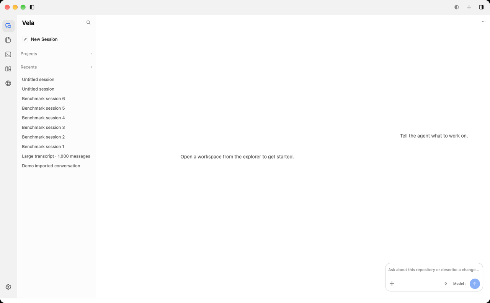
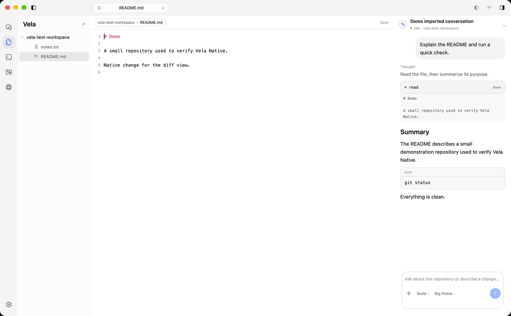
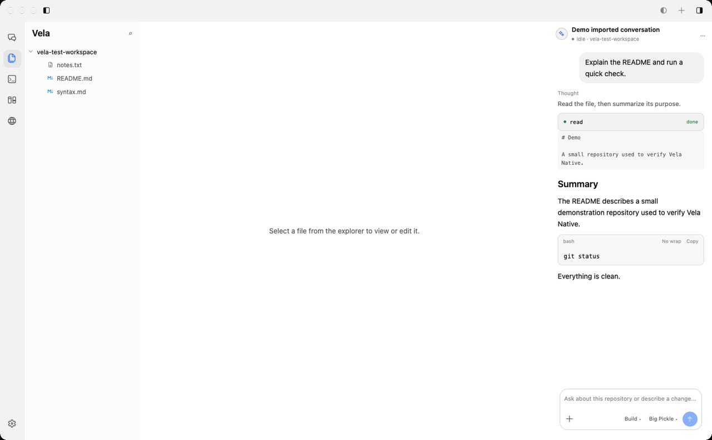
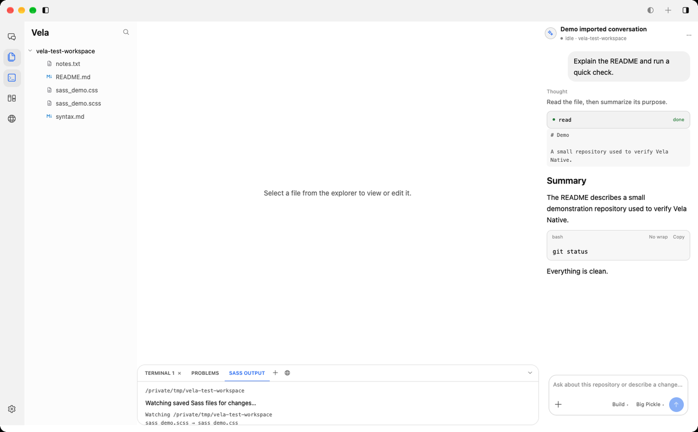
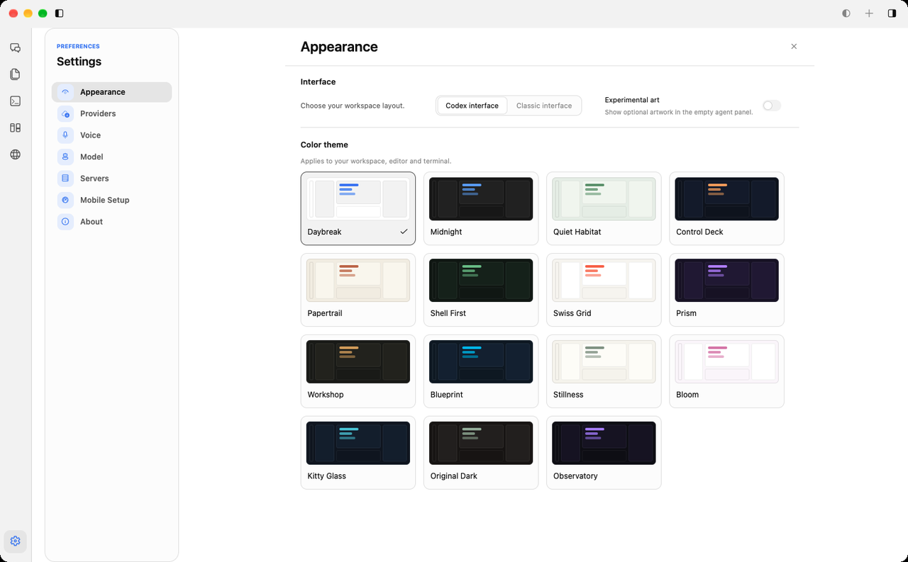
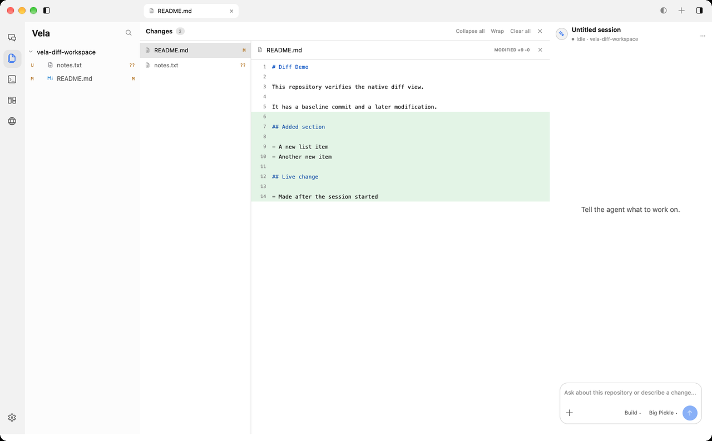
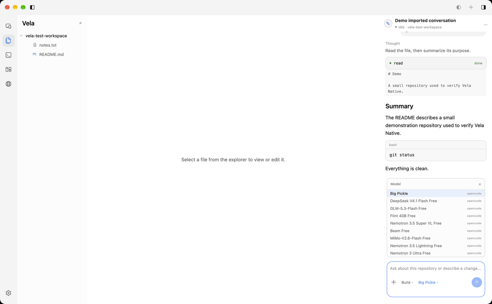
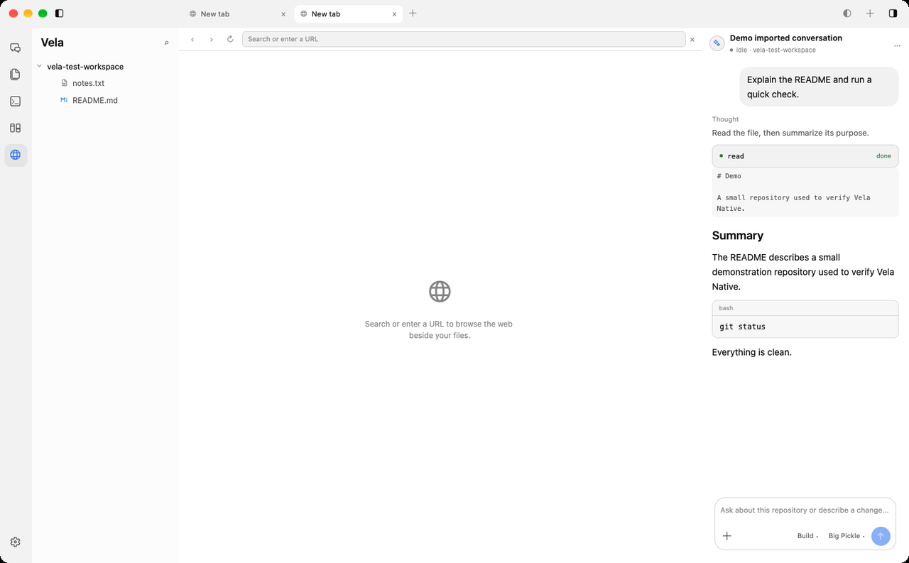
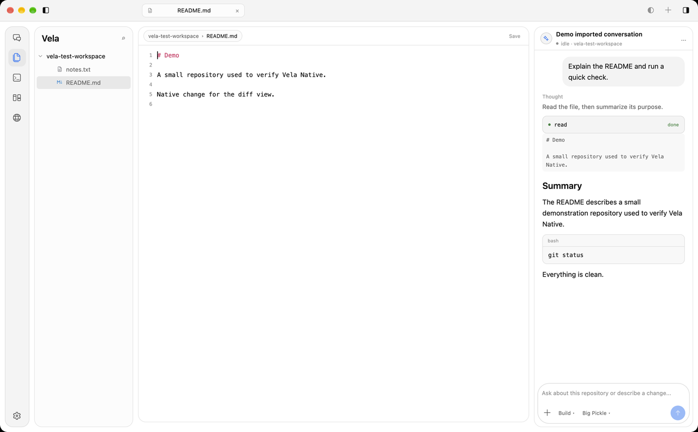

# Vela

Vela is a native desktop app built with Rust, GPUI, Tokio, OpenCode V2, and
platform-native web views. It is the native successor to the original Electron
app, which is archived under `archive/vela-electron/`.

The original Electron implementation is preserved for reference. The native app
reads Vela-owned data and writes only to its own profile.

The Codex interface is the default shell. Classic remains selectable in
**Settings → Appearance**, together with all 15 source appearance palettes.
The migration is in progress; no page has passed final visual acceptance.

The images below are earlier development captures. Current paired comparisons,
lossless capture manifests and outstanding validation are under `docs/parity/`.



















## Status

The native foundation includes OpenCode V2 streaming/replay, virtualized
transcripts, warm sessions, basic permissions/todos/queue/catalogs, a terminal
dock, Git status/diffs and Sass output. Native browser tabs retain views and
history and share a nonpersistent macOS partition.

Workspace-owned documents retain text and undo across navigation. The source
editor has native Unicode input, selection, clipboard, wrapped/virtualized
lines, preview/pinned tabs and recoverable snapshot saves with conflict controls.
Native file observation reloads clean buffers and preserves dirty conflicts,
renamed-buffer ownership and undo. Source/language tooling, split editors,
complete Changes/recovery flows, remaining OS quit validation, multi-panel sessions, forms,
attachments, settings operations, terminal
and Git operations, mobile, packaging and complete visual parity remain
unfinished. `docs/migration/feature-parity-matrix.md` records the current gaps.

The repository is published at
[github.com/Tsohnle95/vela](https://github.com/Tsohnle95/vela).
Screenshots use a disposable test workspace; no credentials or personal
transcripts are stored in this implementation.

## Run

```sh
cargo run -p vela -- --workspace /path/to/repository
cargo test --workspace
./scripts/bench-core.sh
```

OpenCode V2 must be on `PATH`. The app discovers the shared service or starts
`opencode serve --service`.

See `docs/architecture.md` for module boundaries, `docs/development.md` for
setup and isolated-service testing, and `docs/performance/native-results.md`
for measured results.
