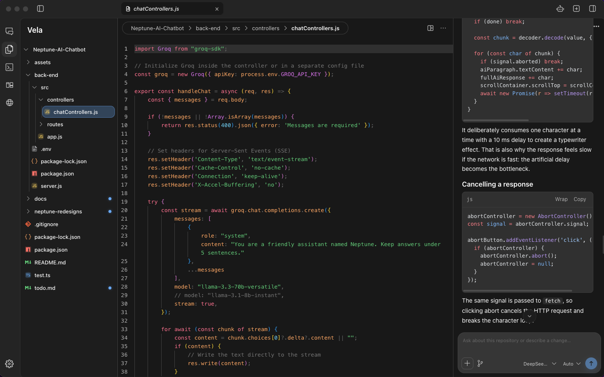

<div align="center">
  
  <h1>Vela</h1>
  <p>A desktop app for coding with an AI agent.</p>
</div>

<div align="center">
  
</div>

Vela puts the file tree, editor, terminal, and agent chat in one window. Open a folder, ask the agent for a change, check the diff, and run the project without jumping between apps.

It's an Electron app: React and Monaco in the renderer, Node in the main process. Agent sessions run through OpenCode V2.

## What it does

**Browse and edit.** Open a single file or a whole repository. Monaco gives you tabs, autosave, and the usual editing tools.

**Work with an agent.** The agent panel runs an OpenCode session. Responses stream in with reasoning and tool calls. You can choose the model and agent, attach files, reference workspace files with `@`, and queue a follow-up while the agent is still working.

**Run agents side by side.** Agent mode tiles up to eight sessions in one workspace. Each panel keeps its own session and context.

**Use the terminal.** Vela has an integrated terminal for the current workspace, and an agent panel can switch to the OpenCode TUI.

**See what changed.** Vela watches the workspace and lists the files touched during the session. When it has a file's starting contents it shows a real diff. When it doesn't, the file is marked as observed instead of showing a guessed diff.

**Use your phone.** Pair the mobile companion from Settings → Mobile Setup and use the same sessions while the desktop app is open.

## Setup

You need:

- Node 22.23.2 or newer on the 22.x line
- npm
- `opencode` V2 on your `PATH`. Vela connects to a running service, or starts one with `opencode serve --service`.
- macOS for the best-tested experience. Linux and Windows work for development, but get less validation.

Run it from source:

```sh
npm install
npm run dev
```

Open a folder in the app to start a workspace session.

Build it:

```sh
npm run build         # compile and launch
npm run build:compile # compile only, into out/
npm start             # launch the existing build
npm run pack          # package Vela.app for macOS
npm run install-app   # build, package, and install to /Applications
```

## Checks

```sh
npm test
npm run typecheck
npm run check          # typecheck, tests, docs, architecture, compile
npm run test:platform  # native launcher, PTY, and filesystem checks
```

## Docs

[Architecture](docs/architecture.md) · [Main process](docs/main.md) · [Renderer](docs/renderer.md) · [Events](docs/events.md) · [Operations](docs/operations.md)
