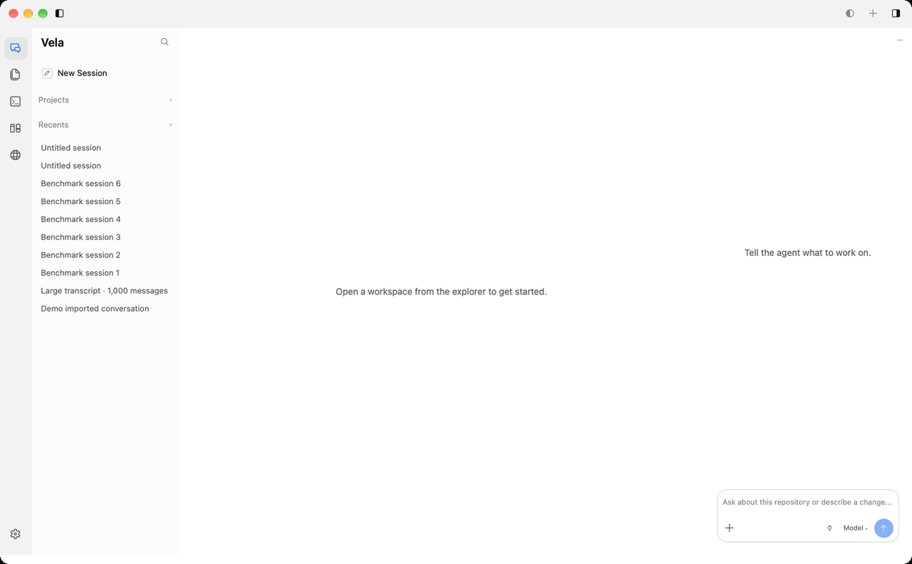
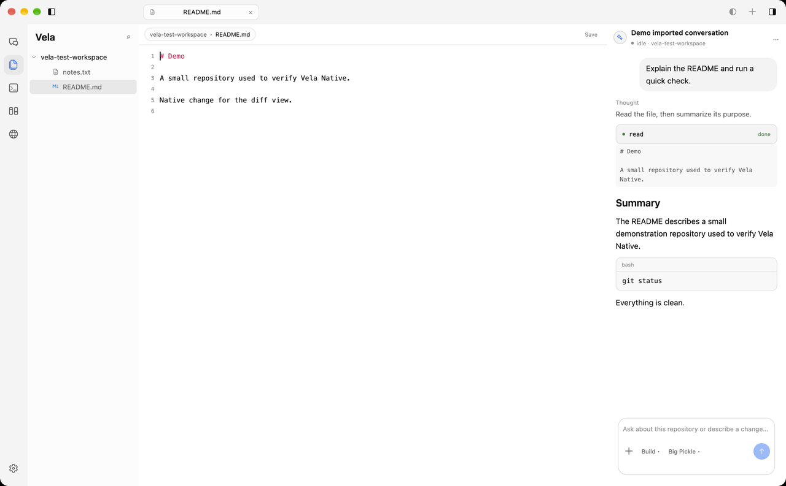
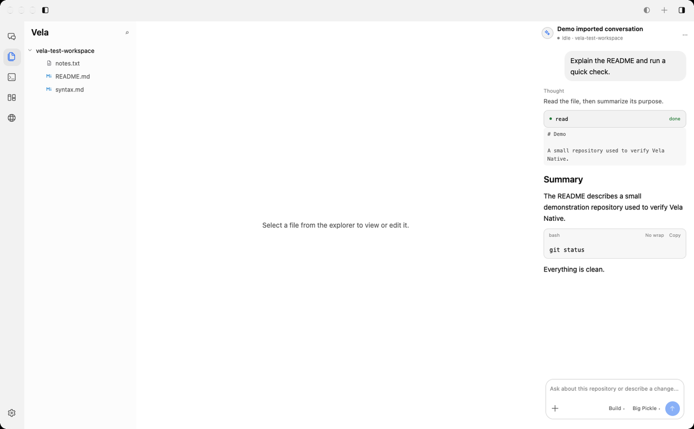
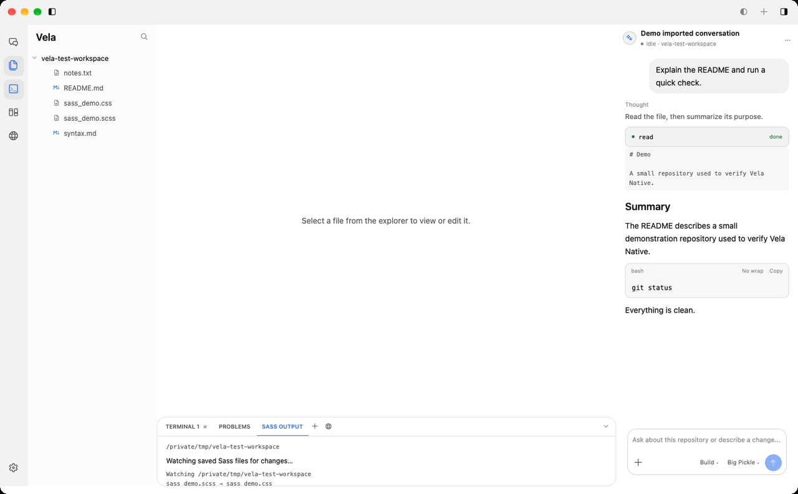
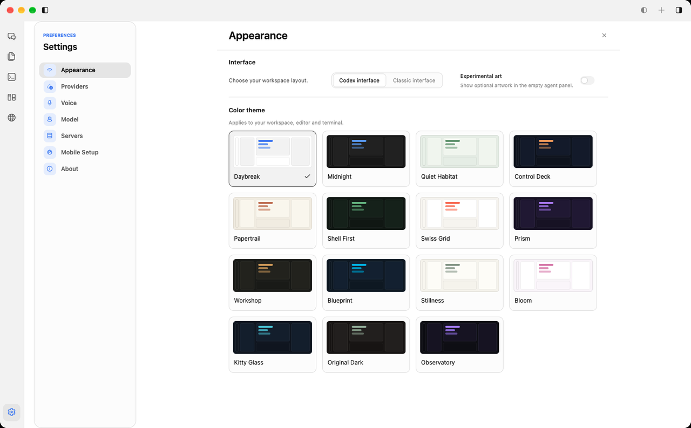
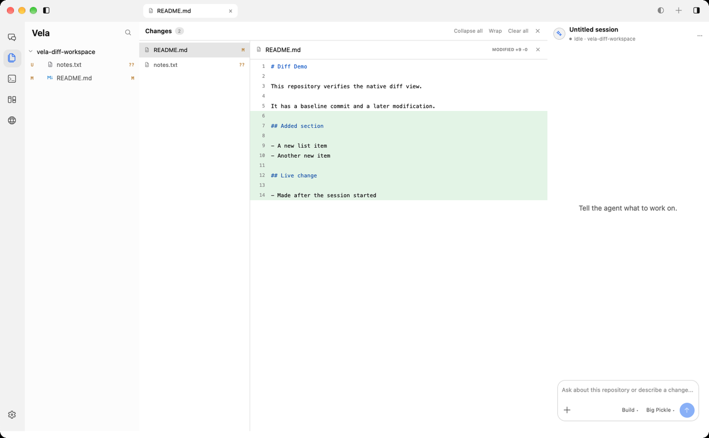
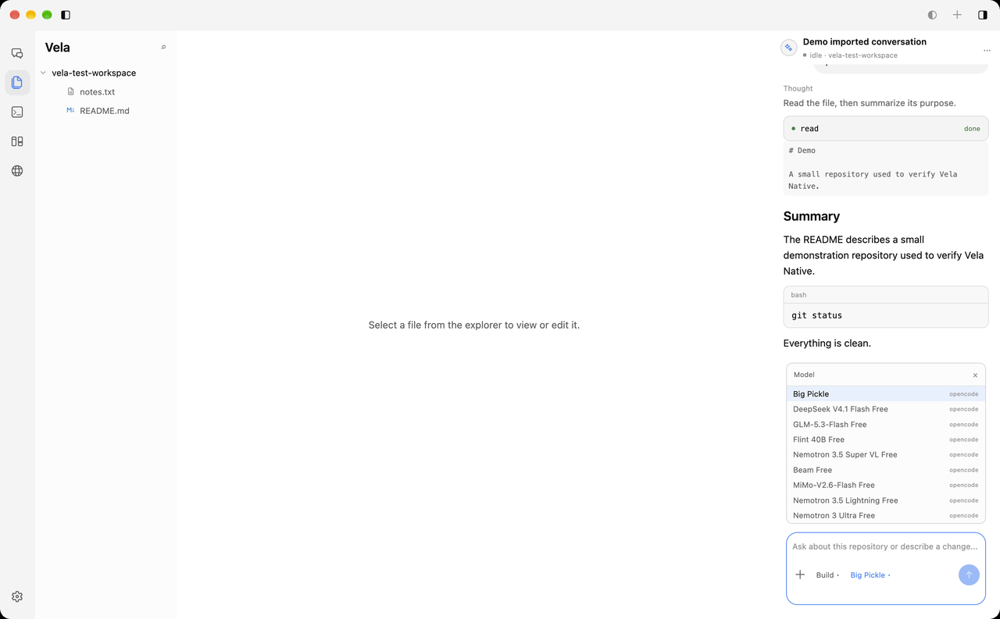
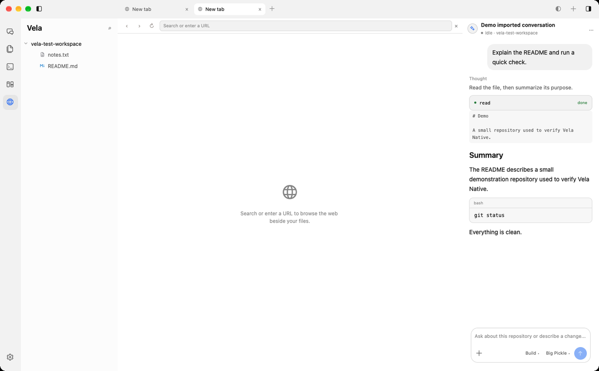
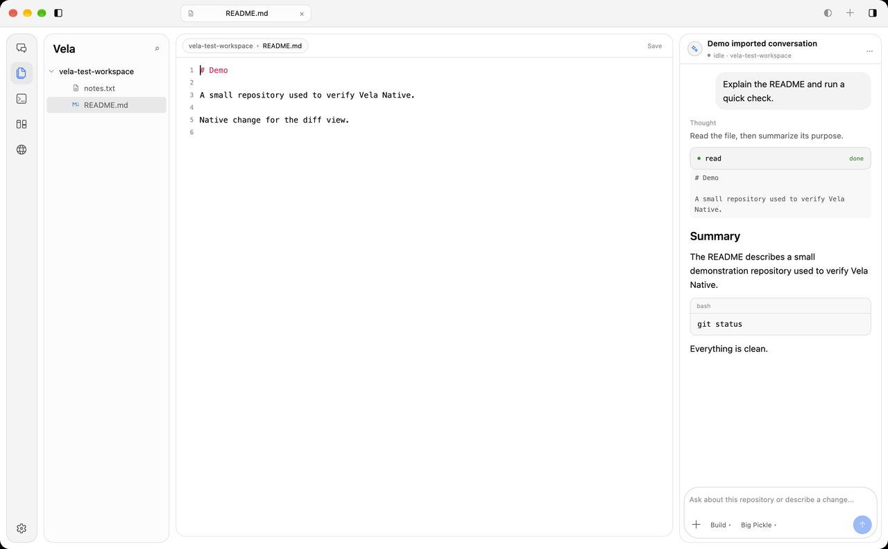

# Vela

Vela is a native desktop app built with Rust, GPUI, Tokio, OpenCode V2, and
platform-native web views. It is the native successor to the original Electron
app, which is archived under `archive/vela-electron/`.

The original Electron implementation is preserved for reference. The native app
keeps its own preferences in its own profile; it also reads and writes user
workspaces, Sass output, downloads, and explicitly opened external files.

The Codex interface is the default shell. Classic remains selectable in
**Settings → Appearance**, together with all 15 source appearance palettes.
The migration is in progress; no page has passed final visual acceptance.

The images below are earlier development captures. Current paired comparisons,
lossless capture manifests and outstanding validation are under `docs/parity/`.



















## Status

The native app includes OpenCode V2 streaming/replay, virtualized transcripts,
warm sessions, simultaneous agent panels, permissions/todos/queue/catalogs,
native terminal and browser surfaces, a source editor and explorer, Git
status/diffs, provider/settings surfaces, and Sass output. Activation-scoped
documents retain text and undo across navigation; native observation reloads
clean buffers and preserves dirty conflicts.

The migration is incomplete. No page has passed final visual acceptance, and
live IME, VoiceOver, provider, browser-isolation, PTY/TUI, packaging, mobile, and
cross-platform validation remain open. `docs/migration/feature-parity-matrix.md`
is the authoritative feature record; do not infer completion from this summary.

The repository is published at
[github.com/Tsohnle95/vela](https://github.com/Tsohnle95/vela).
Screenshots use a disposable test workspace; no credentials or personal
transcripts are stored in this implementation.

## Run

```sh
bash scripts/verify.sh
cargo run -p vela -- --workspace /path/to/repository
./scripts/bench-core.sh
```

OpenCode V2 must be on `PATH` or supplied with `VELA_OPENCODE_BINARY`. The app
discovers the shared service or starts `opencode serve --service`.

Build output defaults to the sibling `build-junk/vela-target` directory via
`.cargo/config.toml`; it is disposable and not part of the repository.

See `docs/architecture.md` for module boundaries, `docs/development.md` for
setup and isolated-service testing, and `docs/performance/native-results.md`
for measured results. Contributors and coding agents start at `AGENTS.md` and
`docs/agent-execution.md`.
