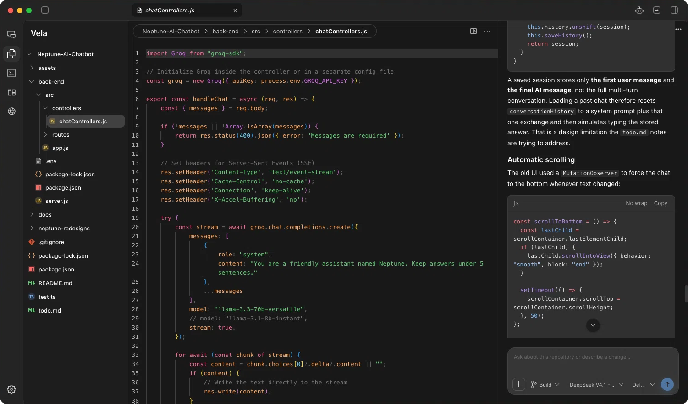

# Vela

A native macOS coding agent: the agent, the code, a terminal, and a browser in
one window.



Point it at a repo and it drives an OpenCode agent against it. The transcript is
drawn natively instead of inside a webview — streaming Markdown, tool cards that
expand into the actual command output and diffs, reasoning you can open, turn
timers, and copy/undo/edit on any message. Transcripts are virtualized, so a
session with thousands of messages still scrolls, and warm sessions swap back in
without a reload.

Run several at once. Agent Mode tiles up to eight sessions across the window,
each with its own draft, scroll position, model, and pending permission prompts,
so a slow agent on one panel doesn't stall the other seven.

Around that sits the editor you'd want anyway: tabs, split panes, syntax
highlighting for a long list of languages, find and replace, formatting,
diagnostics, and conflict handling when another tool rewrites a file you have
open. Git changes and diffs, a real PTY terminal, an embedded browser, and
Sass/preview output for front-end work all live in the same window.

Everything is local. Settings, providers, sessions and pins live in your own
profile, and the agent reaches OpenCode through a local service.

## Run it

You need macOS, Rust, and OpenCode V2 on your `PATH` — or point
`VELA_OPENCODE_BINARY` at it.

```sh
cargo run -p vela -- --workspace /path/to/your/repo
```

If you'd rather have an app to double-click than a terminal session:

```sh
bash scripts/install-dev-app.sh
```

That builds and installs "Vela Dev" into `~/Applications` with its own isolated
profile, so it can't touch your real Vela data. Quit it with Cmd+Q before you
re-run the installer.

Checks: `bash scripts/verify.sh`. Builds land in the sibling `build-junk/`
directory, which you can delete whenever you like.

## Notes

It's early, and I'd rather say that than pretend otherwise. The agent surfaces
are in daily use; IME input, VoiceOver, packaging and browser isolation are
still rough.

Written in Rust on GPUI. The shell, domain model, engine, OpenCode adapter,
terminal, and browser are separate crates — `docs/architecture.md` has the map,
`docs/development.md` covers setup and running against an isolated service.
